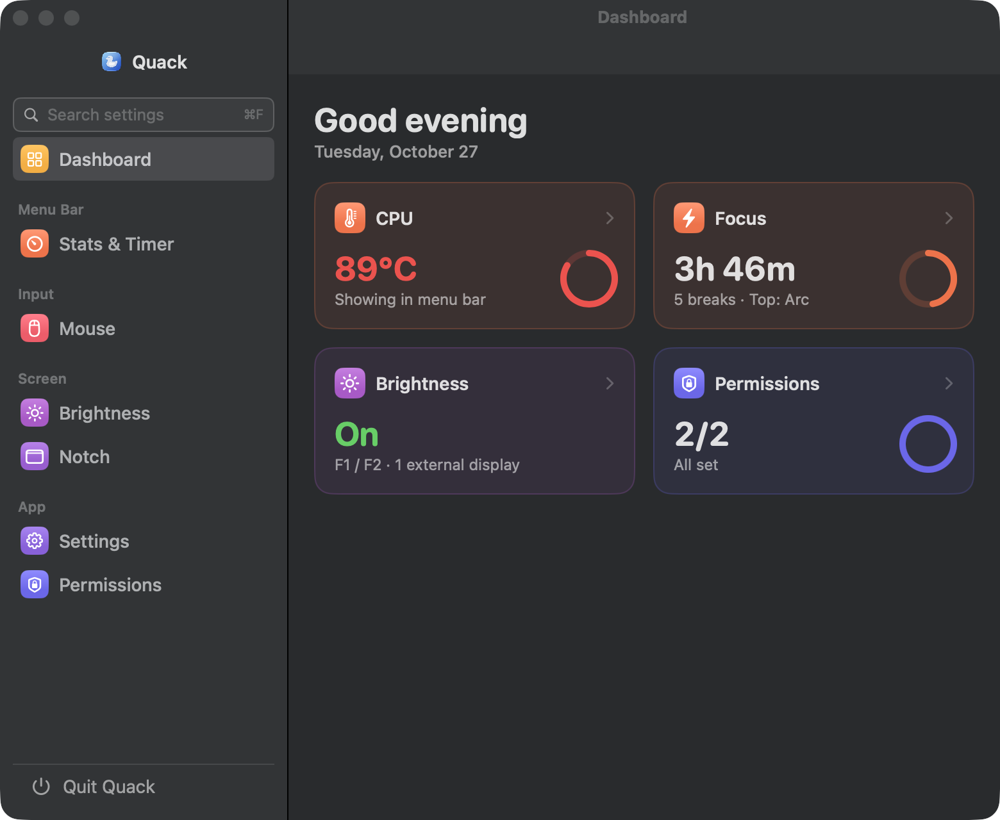
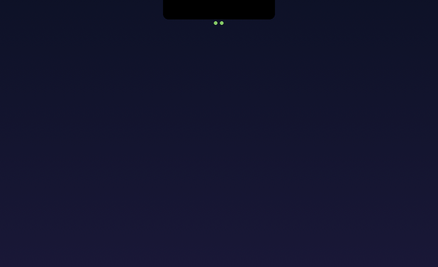
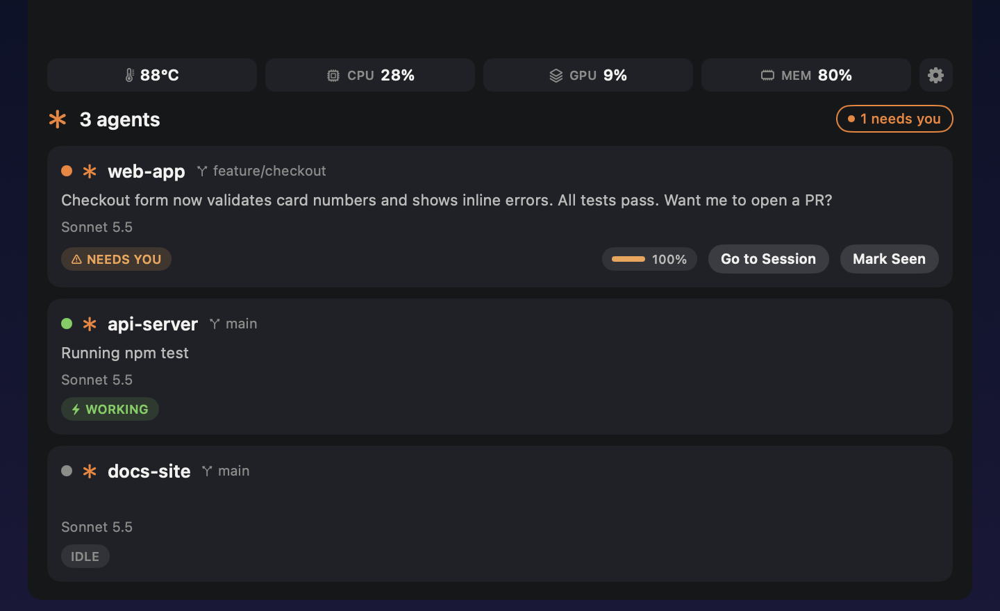
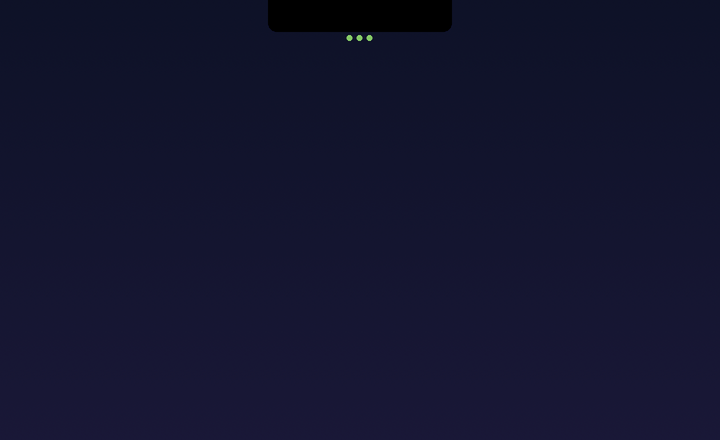
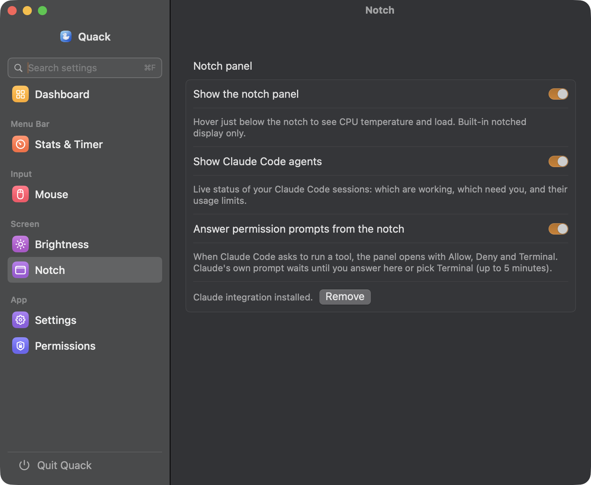
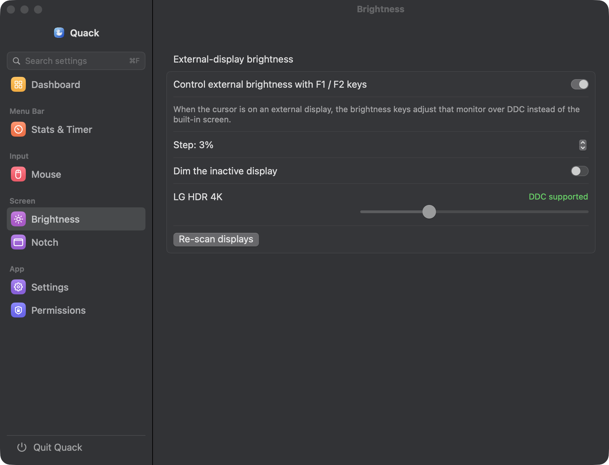
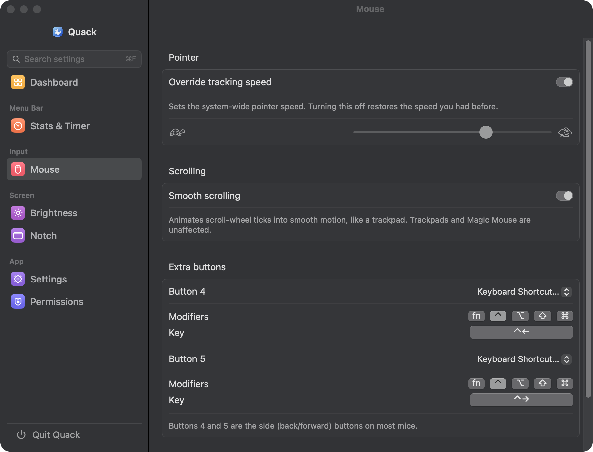

<p align="center">
  
</p>

<h1 align="center">Quack 🦆</h1>

<p align="center"><em>All shortcuts in one app. Quack Quack!</em></p>

<p align="center">
  
  
  
  
</p>

A native macOS menu-bar utility that bundles the little power-tools you'd
otherwise install a few apps for: external-monitor brightness on the F1/F2 keys,
mouse tweaks, a CPU temperature readout, activity/break tracking, and a
**notch panel that keeps an eye on your Claude Code sessions**.

Lives in the menu bar (no Dock icon). Every feature is individually toggleable,
and services start **only** when their toggle is on.

<p align="center">
  
</p>

---

## 🦆 The notch panel

On a notched MacBook, Quack turns the space under the notch into a live view of
your Claude Code sessions. Tiny status dots hang below the notch while agents
are running (green = working, orange = needs you). Hover them and the panel
springs open with system load and one card per session.

**When a session needs you, the panel pops open on its own** — no hovering
required — and highlights it with **Go to Session** and **Mark Seen** buttons.
It tucks itself away again after a few seconds.

<p align="center">
  
</p>

<p align="center">
  
</p>

- **Live agent cards** — project, branch, what Claude is doing right now, model,
  context/cost/rate-limit stats and a to-do progress pill.
- **Answer from the notch** — permission prompts and questions appear as cards
  with the real choices (Allow / Deny / Terminal, or the options Claude offers).
  Claude's own prompt keeps waiting until you answer, or for up to 5 minutes.
- **Go to Session** jumps to the Claude desktop session; **Mark Seen** clears
  *Needs you* until that session works or asks again.
- **System row** — CPU temperature, CPU / GPU / memory load, and a gear that
  opens Quack's settings.
- **Esc** minimizes the panel. A waiting request stays waiting — hover to bring
  it back.

<p align="center">
  
</p>

Enable it under **Notch** in Settings. Turning on *Show Claude Code agents*
installs small hooks into `~/.claude/settings.json` (removable with one click).
Built-in notched displays only.

<p align="center">
  
</p>

---

## ✨ Features

| | Feature | What it does | Permission |
|---|---|---|---|
| 🦆 | **Notch panel** | Live Claude Code sessions under the notch, pop-up when one needs you, answer permission prompts without leaving your editor | — |
| 🌡️ | **CPU temperature** | Live temperature (°C/°F) in the menu bar, read from the Mac's sensors, à la `hot` | — |
| ☀️ | **External brightness** | F1/F2 control whichever external display the cursor is on, over DDC — with software dimming **below** the hardware floor | Accessibility¹ |
| 🖱️ | **Mouse** | Pointer-speed override, buttery smooth scrolling for wheel mice, and custom actions on buttons 4/5 (Mission Control, media keys, any shortcut…) | Accessibility² |
| ⏳ | **Time awareness** | Menu-bar timer of continuous activity with a per-app breakdown; break reminders; daily statistics with a 30-day day-by-day view | — |

¹ The brightness slider works without Accessibility; only intercepting F1/F2
needs it (to consume the key so the built-in display doesn't also change).
² Only smooth scrolling and button remapping need it; the pointer-speed
slider works without.

<p align="center">
  
  &nbsp;
  
</p>

---

## 📦 Requirements

- **macOS 13 Ventura** or later
- **Apple Silicon** for external brightness (DDC over `IOAVService`); Intel runs everything else
- A display that supports **DDC/CI** — Settings shows "DDC supported / not supported" per display

---

## 🚀 Install

Builds with **Swift Package Manager** — no full Xcode, just Command Line Tools
(`xcode-select --install`).

```bash
./Scripts/install.sh
```

This quits any running copy, builds a release bundle, installs it to
`/Applications/Quack.app`, and relaunches it (Settings opens on launch). Click
the duck → enable what you want.

> **Always run via `install.sh` / the installed copy.** macOS ties Accessibility
> grants to the bundle id + signature at a fixed path. Running from
> the build folder makes grants silently stop working. The stable
> "Quack Local Signing" identity keeps grants across rebuilds.

**Other scripts**

```bash
swift test                 # logic tests (no hardware needed)
CONFIG=release Scripts/build-app.sh   # build build/Quack.app
Scripts/package-dmg.sh     # wrap it in a drag-to-Applications DMG
Scripts/make-icon.sh       # regenerate the .icns from Resources/AppIcon-source.png
```

---

## 🎛️ Usage

- **Duck** — click to open Settings. Hide it via **General → Hide duck icon**.
- **Brightness** — cursor on an external display, press **F1/F2**. Past the
  monitor's minimum it keeps dimming with a software overlay. A native-style HUD
  shows the level.
- **Mouse** — under **Mouse**: tracking-speed slider, smooth scrolling toggle,
  and per-button pickers for buttons 4/5 (incl. recording any keyboard shortcut).
- **Temperature** — toggle under **Stats & Timer**; the menu-bar item shows the
  live reading, click it for thermal pressure.
- **Notch** — hover just below the notch, or let it pop open when a Claude
  session needs you. See [The notch panel](#-the-notch-panel).
- **Time awareness** — toggle under **Stats & Timer**; the menu-bar timer shows time
  since your last real break, its menu lists your top apps, and toasts nudge you
  to rest at the interval you choose. The Dashboard's Time card and the tab's
  Statistics section keep 30 days of daily totals, breaks, and top apps.

---

## 🔐 Permissions

- **Accessibility** — for F1/F2 routing and mouse features.
  Can't be granted programmatically: click **Grant**, flip Quack on in
  System Settings → Privacy & Security → Accessibility. Quack picks it up live.

Each Settings section has an **Open Settings** deep-link if you ever deny one.

---

## 🏗️ Architecture

```
QuackKit (library, fully unit-tested — no system/UI deps)
  Models/      QuackSettings
  Display/     BrightnessMath
  Agents/      AgentReducer (session files → cards), ClaudeSettingsEditor
  Coordinator/ AppCoordinator, ManagedService, Feature
  Permissions/ PermissionStatusMapper · Settings/ SettingsStore

Quack (executable — SwiftUI + AppKit)
  MenuBar/   StatusItemController (duck), TemperatureStatusItem · Toast/ ToastPresenter
  Display/   CursorBrightnessService, BrightnessKeyTap, BrightnessController,
             DisplayDimmer, BrightnessHUD, DDCControl
  Notch/     NotchService (panel window + pop-open), NotchContentView, AgentCardView,
             PermissionCardView
  Agents/    ClaudeStateWatcher, ClaudeConfigInstaller (hooks), AgentsService
  Settings/  SettingsView

C targets (private-API shims, no sandbox)
  CDDC         DDC/CI brightness via IOAVService (m1ddc-style)
  CSMC         CPU temperature via SMC + IOHID
```

All decision logic lives in `QuackKit` behind protocols and pure functions, so
it's unit-testable without hardware or permissions; the app target wires it to
the live frameworks. An `AppCoordinator` starts/stops each service as its flag
flips, so a disabled feature never triggers a permission prompt.

---

## 📤 Sharing / distribution

`Scripts/package-dmg.sh` produces a drag-to-Applications DMG. It's signed with a
local identity, so a friend opens it via **right-click → Open** the first time
(or `xattr -dr com.apple.quarantine /Applications/Quack.app`).

For zero Gatekeeper warnings, sign with a **Developer ID** and notarize:

```bash
SIGN_ID="Developer ID Application: Your Name (TEAMID)" CONFIG=release Scripts/build-app.sh
Scripts/package-dmg.sh
xcrun notarytool submit build/Quack.dmg --apple-id you@example.com --team-id TEAMID --password "app-specific-pw" --wait
xcrun stapler staple build/Quack.dmg
```

**No App Sandbox** by design — it would block DDC over IOKit and global
event taps — so Quack ships as a notarized DMG, not via the App
Store.
